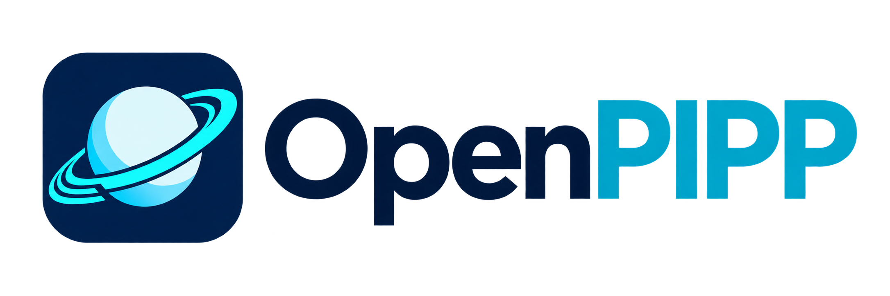

# OPIPP — Open PIPP



[](https://github.com/openpipp/opipp/releases)

Project site: <https://openpipp.github.io/opipp/>

## Download (Windows x64)

Grab the latest self-contained build from **[Releases](https://github.com/openpipp/opipp/releases)**.
Unzip anywhere — no .NET installation needed. It contains the GUI (`Opipp.App.exe`) and the
command-line engine (`Opipp.Cli.exe`).

**OPIPP** (pronounced "oh-pip", *Open PIPP*) is an independent, fully managed continuation of
**PIPP (Planetary Imaging PreProcessor)** by Chris Garry. The name keeps the original's initials so
the lineage stays obvious, while everything in this repository — assemblies, namespaces, executables,
projects — is `Opipp.*`.

## Status: early development — feedback wanted

OPIPP is at **0.1.11-alpha**. The engine is functionally complete and parity-tested against the
original across 27 compared cases, with two declared differences, but one algorithm (surface-feature
tracking) is still one pixel off on part of the real-data fixture, and the UI has not seen broad
real-world use. Treat it as a working preview.

Feedback is genuinely wanted, especially from people who image planets:

- a capture that fails, stalls or produces a worse result than PIPP (SER/AVI plus the command line);
- workflows that are missing or awkward compared with how you actually process;
- anything the port does differently from the original that isn't listed in
  [docs/status.md](docs/status.md).

Open an issue, or start a discussion. "It didn't work on my data" is a useful report — attach the log
from `<output>/logs/`.

## AI-assisted development

Parts of this codebase were written with AI assistance (large language models working from decompiled
output, Ghidra listings and black-box measurements of the original), and AI will continue to be used
for the modernization work. Every behaviour claim is backed by a test or a parity case against the
original binaries; where something could not be verified it is recorded as a known gap in
[docs/status.md](docs/status.md) rather than asserted.

## License

OPIPP is free software: you can redistribute it and/or modify it under the terms of the **GNU General
Public License, version 3 or later**. See [LICENSE](LICENSE).

The licence covers this repository's own code and artwork. It does not relicense PIPP itself, and it
does not make this an official release — see [NOTICE](NOTICE).

## Not affiliated with PIPP

OPIPP is an independent project. It is **not affiliated with, endorsed by, sponsored by, or supported
by** Chris Garry or the PIPP project, and it is not an official PIPP release. "PIPP" names the
original software; "OPIPP" names this independent continuation. Bug reports about the original belong
with the original author, not here.

## Fair use

This project is a clean, managed reimplementation built for interoperability, research and
modernization: it reads the same formats, accepts the same command-line vocabulary, and reproduces the
original's behaviour so existing workflows keep working. Everything in `src/` is new, readable C# —
none of the original binary is redistributed — and the project is published in the belief that this
is fair use. The decompiled and Ghidra output under `decompiled/` and `ghidra/` are development
reference artefacts; they are never shipped, never committed, and are git-ignored.

> Provenance details, including what was and was not copied, are in
> [notes/provenance.md](notes/provenance.md).

## What the original is

| Artifact | Role |
|---|---|
| `PIPP.exe` | WinForms front-end: builds a command line, spawns the engine, parses progress |
| `pipp_core.exe` | the engine: decodes AVI/SER/FITS/images/RAW, debayers, calibrates, aligns, scores, stacks, writes |
| `pipp_dll.dll` | probe + calibration-master stacking helper (statically links libpng) |
| `av*.dll`, `sw*.dll` | FFmpeg 3.x |

The GUI is not the product — the switch vocabulary is. All 152 argument emissions the GUI produces
are documented in [notes/cli-spec.md](notes/cli-spec.md).

## Layout

```
src/Opipp.Core   managed engine: formats, processing, quality, alignment, stacking, pipeline
src/Opipp.Cli    drop-in replacement for pipp_core.exe
src/Opipp.App    .NET 10 WinForms front-end ported from the decompiled UI
tests/          xUnit suites per subsystem + end-to-end pipeline tests
tools/          parity harness against the original engine + fixture generators
docs/           roadmap to feature parity, current status, parity guide, switch matrix
notes/          research trail: CLI spec, algorithms, engine behaviour, provenance
bin/            original binaries, copied read-only (reference only, git-ignored)
decompiled/     ILSpy project for PIPP.exe (14,277 lines of C#, reference only, git-ignored)
ghidra/         4,229 decompiled native functions + CSV index + string-xref tooling (git-ignored)
```

Resuming work: [docs/HANDOFF.md](docs/HANDOFF.md) · progress and what comes next:
[docs/roadmap.md](docs/roadmap.md) · current numbers:
[docs/status.md](docs/status.md) · switch-by-switch state: [docs/switch-matrix.csv](docs/switch-matrix.csv).


## Build and run

Requires the .NET 10 SDK (`dotnet --version` ≥ 10.0).

```bash
dotnet build OPIPP.slnx
dotnet test OPIPP.slnx

# headless engine (same switches as pipp_core.exe)
dotnet run --project src/Opipp.Cli -- -help
dotnet run --project src/Opipp.Cli -- -tif -q=50 -od=out capture.ser

# WinForms front-end
dotnet run --project src/Opipp.App
```

## Status

Working end to end (verified by tests): SER → pipeline → FITS/TIFF/SER/AVI/GIF output, calibration
subtract/divide, histogram stretch, quality selection, alignment, stacking and animation. **926 tests**
across nine projects (0 failing; two skip without the evaluation capture); [`docs/status.md`](docs/status.md) is the authoritative summary.

The CLI is a drop-in engine: it accepts the GUI's stdin protocol (switches and file paths, one per
line) as well as a normal command line, and emits the original `@PROGRESS/@PFILE/...` tokens with
`-gui`. `Opipp.App` now prefers `Opipp.Cli.exe` via `EngineLocator` and only falls back to the legacy
`pipp_core.exe` when the managed engine is absent.

| Area | State |
|---|---|
| SER v3 read/write | complete |
| FITS read/write | complete (8- and 16-bit, Bayer keywords, BZERO); every image unit is 2880-byte aligned |
| AVI | read: uncompressed DIB/Y800 and baseline MJPEG; write: uncompressed DIB/Y800 only. Other compressed codecs (ULRG, FMP4, YUY2, ...) are rejected with a clear error |
| BMP / TIFF / PNG | complete; BMP writes 8/24bpp only (PIPP's reader rejects 16bpp), so 16-bit frames are downshifted and documented |
| PGM / DNG | PGM is a calibration-master input only, not a science format; DNG is read-only (restricted uncompressed subset), not a general camera-RAW reader |
| Debayer (bilinear, smooth hue) | complete; pattern indices match the engine; debayered frames carry no CFA marker, an explicit pattern overrides headers, and raw geometry retags the phase |
| Binning, median, mono modes, stretch, gain/gamma, flip/rotate/crop/resize | complete |
| Dark/flat calibration | complete; masters via `.tmp` (preferred) or PGM, corrected flat applied exactly once |
| Quality sort/limit | complete contract; score formulas are reconstructions |
| Alignment | centroid + NCC translation + AFB box |
| Stacking | mean / sum / median |
| CLI | all 131 switch labels parse; 76 verified against the engine, 43 wired, 12 inert (see `docs/status.md`) |
| Not equivalent yet | surface-feature tracking (23/30 frames exact), RAW/dcraw absolute values, 16-bit Bayer debayer — see `docs/status.md` |
| WinForms UI | builds on .NET 10; drives the managed CLI through the original stdin/stdout protocol (legacy binary as fallback) and builds master darks/flats in-process when `pipp_dll.dll` is absent |

### Parity against the original engine

`tools/Opipp.Parity` runs `bin/pipp_core.exe` and `Opipp.Cli.exe` on the same synthetic capture with the
same switches and compares the produced frames by SHA-256 of their sample data:

```
dotnet run --project tools/Opipp.Parity
```

Current result: **27 of 27 compared cases match**, with two deliberate differences declared separately (29 cases in total), comparing pixel content, directory layout (`capture/1.tif`,
`logs/capture_pipp_log.txt`) and log text as well as pixels — plain TIFF, `-hs=204` stretch,
`-flip_x`, `-fits`, `-png`, `-avi`, `-db=2` debayer, `-ctr` centring and `-q=2` quality selection.
Quality selection is compared as a multiset because it may reorder frames, and its score column is
excluded until the quality algorithm is parity-proven.

The two declared differences in the parity set are 16-bit TIFF (the original byte-swaps samples
under an `II` header; we write spec-correct files) and GIF (the original emits an image-less file; we
write a valid animation). The `-gui` stdout is byte-identical across all nine recorded transcript
scenarios. Colour SER output is a documented superset of the original's mono-only help text, not a
parity claim (see [notes/algorithms.md](notes/algorithms.md)).

Details of what is observed versus reconstructed: [notes/algorithms.md](notes/algorithms.md).

## Documentation

- [notes/00-plan.md](notes/00-plan.md) — scope, architecture, modernization decisions
- [notes/engine-behaviour.md](notes/engine-behaviour.md) — pipeline order, constants, stdout protocol
- [notes/cli-spec.md](notes/cli-spec.md) — every switch with the GUI guard that emits it
- [notes/algorithms.md](notes/algorithms.md) — evidence per algorithm
- [notes/provenance.md](notes/provenance.md) — licensing status
